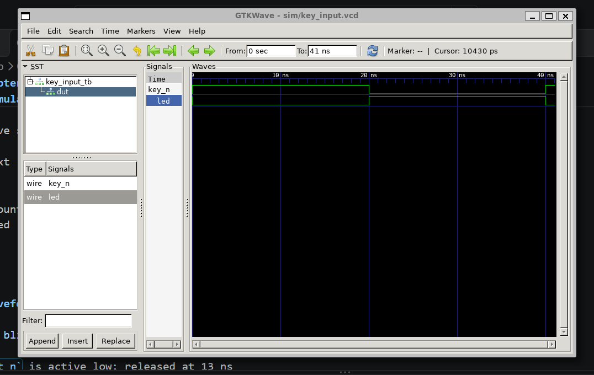

# Chapter 02 - Key Input

## Overview

An active-low key input controls an LED directly. This chapter introduces FPGA input handling.

Topics: FPGA GPIO input, active-low signals, combinational logic, testbench stimulus, waveform verification.

---

## Directory Structure

```text
02-key/
├─ rtl/
│  └─ key_input.v
├─ tb/
│  └─ key_input_tb.v
├─ sim/
│  ├─ key_input_tb
│  └─ key_input.vcd
├─ images/
│  └─ key_input_waveform.png
└─ README.md
```

---

## Design

This design uses one input signal and one output signal:

```verilog
module key_input (
    input  wire key_n,
    output wire led
);
```

The key is active low:

```text
key_n = 0  means the key is pressed
key_n = 1  means the key is released
```

The LED follows the inverted key signal:

```verilog
assign led = ~key_n;
```

This is combinational logic. There is no clock, no state machine, and no counter.

---

## Signal Table

| Signal | Dir | Description |
|--------|-----|-------------|
| `key_n` | in | Active-low key input |
| `led` | out | LED output |

Active-low behavior:

| key_n | led |
|--------|-----|
| 0 | 1 |
| 1 | 0 |

---

## Block Diagram

```text
       +-----------+
key_n ->| Key Logic |
        +-----+-----+
              |
              v
             led
```

---

## Behavior

When the key is released, `key_n` is high:

```text
key_n = 1
led   = 0
```

When the key is pressed, `key_n` is low:

```text
key_n = 0
led   = 1
```

Because the circuit is combinational, the LED changes as soon as the input changes.

Expected timing:

```text
0 ns   key_n = 1, led = 0
20 ns  key_n = 0, led = 1
40 ns  key_n = 1, led = 0
```

On real hardware, many FPGA development boards connect push buttons as active-low signals. Pressing the button pulls the input to `0`, and releasing the button lets it return to `1`.

---

## Simulation

Run from the `02-key/` directory.

```bash
iverilog -o sim/key_input_tb rtl/key_input.v tb/key_input_tb.v   # compile
vvp sim/key_input_tb                                             # run
gtkwave sim/key_input.vcd                                        # view waveform
```

Expected output:

```text
VCD info: dumpfile sim/key_input.vcd opened for output.
PASS: Key input behavior is correct
```

GTKWave signals (hierarchy: `key_input_tb` -> `dut`):

```text
key_n
led
```

---

## Waveform



- At 0 ns, `key_n` is high and `led` is OFF
- At 20 ns, `key_n` goes low and `led` turns ON
- At 40 ns, `key_n` goes high and `led` turns OFF

---

## Verification Checklist

- [ ] LED OFF when key released
- [ ] LED ON when key pressed
- [ ] Active-low behavior verified
- [ ] Simulation reports PASS

---

## Next Chapter

### Chapter 03 - PLL

Chapter 02 introduces a simple external input. Chapter 03 moves on to clock handling with a PLL.

```text
Chapter 02:  Key input
Chapter 03:  PLL
```

Topics: clock input, PLL output clock, clock generation, clock verification.
